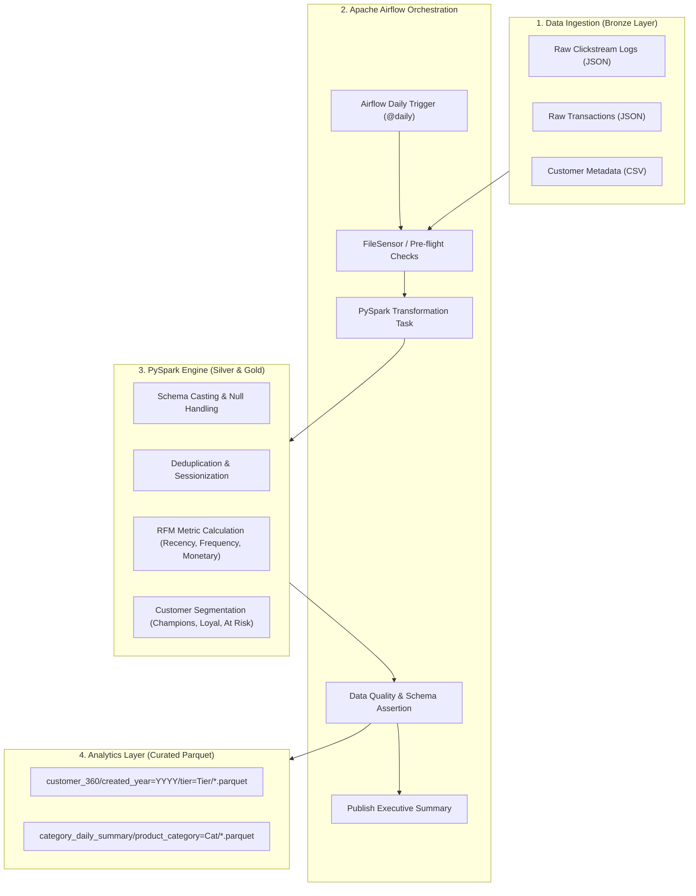

# Customer 360 PySpark & Apache Airflow ETL Pipeline

A production-grade, distributed data engineering pipeline that orchestrates automated ingestion of high-volume clickstream logs and customer transaction records, cleans and aggregates behavioral metrics using **PySpark**, and writes optimized, partitioned **Parquet** files into an analytics lakehouse layer.

---

## Architecture Overview



---

## Key Features

1. **Automated Airflow Orchestration**:
   - Daily schedule with idempotent runs, SLA timeouts, and configurable retry policies (`retries=2`, `retry_delay=2m`).
   - Task dependency graph ensuring inputs exist before Spark triggers, followed by post-load data quality assertions.

2. **Distributed PySpark Transformations**:
   - **Data Cleaning**: Coalesces missing emails to fallback domains, drops duplicate event IDs, and filters failed/refunded orders.
   - **Sessionization & Engagement**: Window aggregations computing total sessions, dwell times, cart conversion ratios, and favorite category.
   - **RFM Customer Segmentation**: Calculates Recency (days since last order), Frequency (order count), and Monetary (lifetime spend) metrics to classify users into:
     - `Champion`: High spend (≥ $500) and recent purchase (≤ 30 days).
     - `Loyal Regular`: Frequent repeat purchaser (≥ 3 orders).
     - `At Risk / Inactive`: Lapsed customers (> 60 days since order).
     - `Prospect / Browser`: Browsed products with 0 completed orders.

3. **Optimized Parquet Lakehouse Storage**:
   - Output compressed using Snappy.
   - Partitioned by `created_year` and customer `tier` (`Platinum`, `Gold`, `Silver`, `Bronze`) for predicate pushdown in Trino, Presto, Athena, Spark SQL, or Snowflake.

4. **Data Quality & Schema Integrity**:
   - Automated pre-write assertions: zero-row check, non-null primary key enforcement, and negative price rejection.

---

## Project Structure

```
spark-airflow-etl-pipeline/
├── dags/
│   └── customer_etl_dag.py        # Apache Airflow DAG definition
├── scripts/
│   ├── transform_data.py          # Core PySpark transformation & RFM logic
│   ├── generate_sample_data.py    # Realistic clickstream & transaction data generator
│   └── run_pipeline_local.py      # Standalone runner for instant local execution
├── tests/
│   ├── __init__.py
│   └── test_transformations.py    # Pytest unit tests for Spark transformations
├── data/
│   ├── raw/                       # Raw landing zone (customers.csv, clickstream.json, transactions.json)
│   └── curated/                   # Output partitioned Parquet lakehouse
├── docker-compose.yaml            # Local Apache Airflow (Webserver + Scheduler + Postgres)
├── requirements.txt               # Python dependencies
├── .gitignore
└── README.md
```

---

## Quickstart & Execution

### 1. Prerequisites
- **Python**: 3.10 or 3.11
- **Java**: OpenJDK 17 or 21 (required by Apache Spark)

### 2. Install Dependencies
```bash
pip install -r requirements.txt
```

### 3. Run Pipeline Locally (One Command)
Run the complete pipeline end-to-end (generates mock data, runs PySpark ETL, and runs analytical verification queries):

```bash
python3 scripts/run_pipeline_local.py
```

### 4. Run PySpark Unit Tests
```bash
pytest tests/ -v
```

---

## Running with Apache Airflow (Docker)

To launch the full containerized Airflow UI and scheduler:

```bash
# 1. Initialize Airflow database
docker compose up airflow-init

# 2. Start Airflow Webserver and Scheduler
docker compose up -d
```

- Open the Airflow UI at **http://localhost:8081** (username: `airflow`, password: `airflow`).
- Locate the DAG **`customer_360_pyspark_etl`** and trigger the pipeline.
